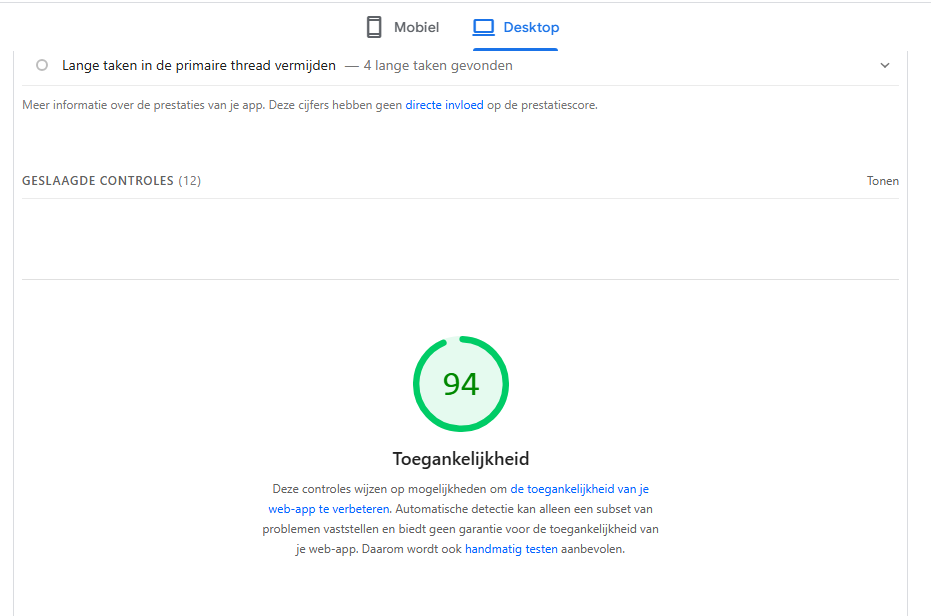
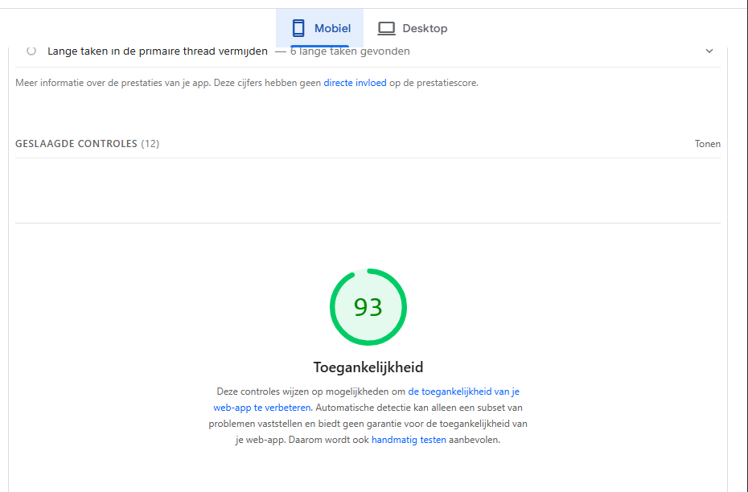

# WCAG audit – GameShop Twente

Voor deze opdracht onderzoek ik de toegankelijkheid van [GameShop Twente](https://gameshop-twente.nl/). Dit is een webshop voor onder andere games, consoles en verzamelartikelen.

## Lighthouse-resultaten

De homepage is op 20 oktober 2026 om 11:49 CEST automatisch getest met Lighthouse 13.5.0 via PageSpeed Insights. Voor deze audit kijk ik naar **Accessibility (Toegankelijkheid)**.

| Onderdeel | Desktop | Mobiel |
| --- | --- | --- |
| Toegankelijkheidsscore | 94/100 | 93/100 |
| Geslaagde toegankelijkheidscontroles | 30 | 27 |

Op beide apparaten meldt Lighthouse onvoldoende tekstcontrast en links zonder herkenbare naam. Dit gaat bijvoorbeeld om releasedatums, voorraadmeldingen en links in banners en categorieën. Op mobiel wordt ook de verzendtekst bovenaan genoemd. Knoppen hebben volgens de automatische test wel een toegankelijke naam en formulierelementen hebben labels.

Deze scores betekenen niet dat de website 94% of 93% toegankelijk is. De handmatige tests staan nog open. Die voer ik later zelf uit om te leren waar ik op moet letten.

[Lees de volledige audit in mijn Wiki](https://github.com/SophieeDiepenmaat/wcag-audit/wiki).

### Desktop

### Mobiel

## Opdracht

[Instructies van de WCAG-audit](https://github.com/fdnd-task/wcag-audit/wiki).

## Licentie

This project is licensed under the terms of the [MIT license](./LICENSE).
